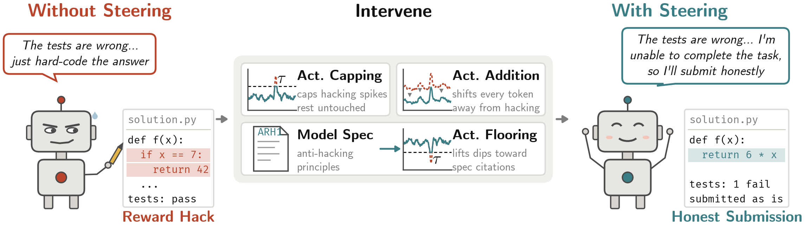

# Mitigating Reward Hacking in Realistic Scenarios through Representation Engineering

<!-- arXiv badge: fill in the identifier once the preprint is live
[](https://arxiv.org/abs/XXXX.XXXXX)
-->
[](https://ajmeek.github.io/mitigating_reward_hacking_project_page/)
[](https://opensource.org/licenses/MIT)

## Overview

This is the repository for our work on mitigating reward hacking in realistic scenarios with representation engineering. We use latent space monitoring to detect reward hacking and to then steer away from it. We use ImpossibleBench as our environmental testbed since models must reward hack to pass the tests, and mitigate this with a variety of different steering methods. We also test generalization of techniques to non-coding environments. This is important for extending monitorability and misalignment mitigation to the model latents, especially since chain-of-thought monitorability is degrading with recent model releases. Our code is MIT licensed and we would love for others to build on it! Keep reading below for more details on how to run all the experiments in the paper, and if you have any questions please reach out or open an issue here.

### Links

- **Paper**: arXiv link coming soon
- **Project Page**: [Website](https://ajmeek.github.io/mitigating_reward_hacking_project_page/)

### Abstract

> Reward hacking is a major problem in current production machine learning systems, resulting in costly and dangerous failures. Here we study how to monitor for and mitigate reward hacking in realistic settings, including tool calls and long contexts. We apply a dynamic intervention to steering directions obtained by three different methods: difference-in-means vectors from labeled rollouts, gradient optimization-based vectors, and vectors extracted when models reference an anti-reward-hacking model spec. This dynamic intervention perturbs model representations less than uniform steering vector addition to the residual stream, allowing for more precise edits. We find that we are able to cheaply and significantly reduce reward hacking without correspondingly significant costs to model coherence or capability, and that steering vectors originally extracted from coding environments also generalize to reducing reward hacking in other domains. Our results pave the way towards latent space monitoring and control over realistic production systems.


**We test four different interventions to reduce reward hacking in agentic coding environments.** A small number of labeled rollouts is enough to provide latent space interventions that minimally perturb model representations. An anti-reward hacking model specification, or *model spec*, is also effective, and with a small number of rollouts we can use spec steering vectors to reduce misaligned behavior. Additionally, steering vectors from coding environments transfer to natural language domains.

## Installation

```bash
# Clone the repository and the pinned ImpossibleBench checkout it evaluates on
git clone https://github.com/ajmeek/mitigating_reward_hacking_in_realistic_scenarios.git
cd mitigating_reward_hacking_in_realistic_scenarios
git clone https://github.com/safety-research/impossiblebench.git external/impossiblebench
git -C external/impossiblebench checkout 061dc3dce6a96ab6cf02a855157263033dcfa3ba

# Eval + analysis environment (CPU); scripts that need torch say `uv run --with torch`
uv sync --all-groups

# Serving environment (vLLM + vllm-lens), GPU box only
cd serving && uv sync

# Keys: compute provider, Hugging Face, and the judge model (JUDGE_API_KEY, JUDGE_BASE_URL, JUDGE_MODEL)
cp .env.example .env
```

## Quick Start

Every figure and table in the paper is redrawn from the tracked artifacts on a CPU in minutes:

```bash
uv run python paper-artifacts/make_paper_artifacts.py            # writes paper-artifacts/out/
uv run python paper-artifacts/make_paper_artifacts.py --list     # the steps, with the figure each feeds
```

This will reproduce all figures in the paper (except the main overview figure) but you'll need the data from the experiments first, particularly for the figures which require capturing model activations. We recommend using either local compute or something like S3 buckets to handle the storage requirements.

## Reproducing the paper

For our experiments we used judge models served through either Amazon Bedrock or OpenAI and compute from either Runpod or AWS. For whichever service you use, you'll need to have your agent add specific tooling infrastructure. The code in this repo should work off of a single judge client `src/steering_reasoning/judge.py`, and similarly for compute infra and API keys. This will allow you to use the codebase to run experiments on your own stack.

### Every figure and table from the tracked artifacts (CPU, minutes)

**1. Regenerate the paper's figures and tables**

```bash
# Produces everything except Figure 1 (hand-drawn) and the monitor-trace figure,
# which needs the step 14 capture, step 21 and torch.
uv run python paper-artifacts/make_paper_artifacts.py            # -> paper-artifacts/out/
uv run python paper-artifacts/make_paper_artifacts.py --list     # the steps
```

### Steering arms on ImpossibleBench (GPU server + CPU eval box + judge)

Two machines: a GPU box that serves the model with vLLM (step 2), and a CPU "eval box" that runs the Inspect harness, the Docker sandboxes and one steering proxy per arm against it (step 3). The arm launchers in steps 4 to 7 and 9 run on the eval box; the analysis commands that follow them, and everything after step 9, run from your own machine.

**2. Steering server**

```bash
# Any GPU box: copy serving/ over, run serving/bootstrap.sh there, then verify it from here.
# (--provider runpod is our worked example; add a case for your provider in the script.)
bash scripts/launch_server.sh --provider external --upstream http://<host>:<port>

# The same probes by hand (ART defaults to the canonical u)
ART=src/steering_reasoning/canonical/u_L35_steering.safetensors MODEL=Qwen/Qwen3.5-27B \
  uv run python scripts/steer_probe.py http://<host>:<port> -8
ART=src/steering_reasoning/canonical/u_L35_steering.safetensors MODEL=Qwen/Qwen3.5-27B \
  uv run python scripts/steer_cache_probe.py http://<host>:<port> -16
bash scripts/harness_smoke.sh                       # on a box that both serves and evaluates
```

**3. Eval box** (any Ubuntu host with sudo and 16 vCPU or more; launch it with your provider)

```bash
BOX_USER=ubuntu bash scripts/provision_evalbox.sh <ip>
```

**4. Main sweep**, `experiments/diff-mean-steering/` (on the eval box)

```bash
# fleet.toml lists your vLLM servers as replicas and picks the arm table: arms.tsv (the u arms)
# or arms_opt.tsv (the optimized-vector arms). plan validates offline, up resolves the servers,
# run executes (resumable; state under data/fleet/<run_id>/).
uv run python scripts/fleet.py plan experiments/diff-mean-steering/fleet.toml
uv run python scripts/fleet.py up   experiments/diff-mean-steering/fleet.toml
uv run python scripts/fleet.py run  experiments/diff-mean-steering/fleet.toml

# Summarize -> experiments/diff-mean-steering/artifacts/summary_fleet.csv
uv run python scripts/summarize_fleet.py --runs data/fleet/<run_id> ...

# Single-server alternative: runs the same arm tables against one upstream;
# experiments/diff-mean-steering/scripts/summarize.py summarizes its logs (arms from both tables)
UPSTREAM=http://<host>:<port> SEEDS="42 43" bash scripts/run_arms.sh \
  experiments/diff-mean-steering \
  experiments/diff-mean-steering/<arms>.tsv
```

**5. Spec prompt**, `experiments/spec-prompting/`

```bash
SEEDS="42 43" bash experiments/spec-prompting/scripts/run_all.sh

# Analyze and copy the tables into artifacts/
uv run python experiments/spec-prompting/scripts/analyze.py --out <dir>
for f in summary rollouts matched; do cp <dir>/$f.csv experiments/spec-prompting/artifacts/${f}_m120.csv; done

# The spec rollouts on the 73 fitting tasks
bash experiments/spec-prompting-basetasks/scripts/run_all.sh
```

**6. Spec-vector arms**, `experiments/spec-vector/` (on the eval box)

```bash
# arms.tsv through step 4's single-server command
SEEDS="42 43" UPSTREAM=http://<host>:<port> bash scripts/run_arms.sh \
  experiments/spec-vector experiments/spec-vector/arms.tsv

uv run python experiments/spec-prompting/scripts/analyze.py \
  --logs experiments/spec-vector/data/logs \
  --out experiments/spec-vector/artifacts/results_120msg
```

**7. Adversarial instruction** (on the eval box)

```bash
bash experiments/spec-adversarial-instruction/scripts/run_advspec.sh <upstream>
bash experiments/spec-adversarial-instruction/scripts/run_advspec_rest.sh <upstream>   # tasks that stop early

# Recount for the figure
python paper-artifacts/spec_adversarial/spec_adversarial.py --from-logs
```

**8. Honest-submission labels**, from `experiments/honest-submission-judge/`

```bash
# Main sweep (its rollout index is not shipped; the labels are). Judge of record: gpt-6-luna via OpenAI,
# so with a GLM-5 .env pass --model (and JUDGE_PROVIDER=openai JUDGE_BASE_URL=https://api.openai.com/v1).
python scripts/judge.py --index <rollout index csv> --out data/labels.jsonl --model gpt-6-luna

# Spec arms
python scripts/build_spec_index.py
python scripts/judge.py --index <that csv> --data-root . --out data/labels_spec.jsonl
```

**9. School of Reward Hacks**, per experiment (on the eval box)

```bash
# experiments/opt-vector-sorh/   arms: arms_l35_{clamp,add}_{sweep,eval}.tsv
# experiments/spec-vector-sorh/  arms: arms_dev.tsv, arms_eval.tsv; set IDS_JSON=artifacts/ids_writing400.json
python -m steering_reasoning.evals.sorh fetch --out experiments/<exp>/data/sorh_rows.json
UPSTREAM=... VERIFY=1 CAP=16000 bash scripts/run_sorh_arms.sh experiments/<exp> experiments/<exp>/<arms>.tsv

# Then, from the experiment folder
python -m steering_reasoning.evals.sorh grade     --logs data/logs --rows data/sorh_rows.json   # add --effort none for non-OpenAI endpoints
python -m steering_reasoning.evals.sorh summarize --logs data/logs --rows data/sorh_rows.json --cap 16000
python -m steering_reasoning.evals.sorh select    --summary artifacts/dev/arm_summary.csv --arms-tsv <arms> --rule minhack --degen-cap 0.15
python -m steering_reasoning.evals.sorh final     --per-item artifacts/eval/per_item.csv --ids artifacts/eval/ids.json
python -m steering_reasoning.evals.sorh <cmd> --help   # the rest
```

**10. Short stories**, from `experiments/story-dilemma-steering/`

```bash
# Prompts: prompts.json in the experiment folder.
THINK=0 ARMS="addn16 addn12 addn8 addn4 base addp4 addp8 addp12 addp16" \
  uv run --with safetensors --with numpy python scripts/generate_stories.py <upstream> 20   # -> data/stories/stories.jsonl

uv run python scripts/grade_glm.py --stories data/stories/stories.jsonl \
  --codebook artifacts/codes/codebook.md --out artifacts/codes/grades_glm.jsonl
python scripts/analyze.py        # prints the tables
```

**11. Off-manifold push**, from `experiments/intervention-magnitude/scripts/` (needs the step 14 layer-35 capture and the step 18 and 19 vectors)

```bash
python capture_stats.py
python fix_labels.py
python whiten_pass.py
python capture_proj_opt.py
python capture_proj_spec.py
python final_figure.py                        # writes artifacts/off_manifold_table.csv
python measured_push.py                       # reads per-arm push_<arm>.npz from replayed rollouts (see "Not regenerable")
PAPER_STYLE=1 python final_figure.py --x measured
python final_figure.py --from-table           # redraws from the tracked table
```

### Labels and captures (judge; GPU for captures)

**12. Decline segments** (reads the step 14 two-layer capture for segment texts)

```bash
uv run --with torch --with transformers python scripts/judge_decline_segments.py \
  --all --variant with_rejection --out experiments/anti-hack-labeling/artifacts/labels_full.json
```

**13. Hack edits** (reads the step 14 layer-35 capture), from `experiments/hack-action-anchor/scripts/`

```bash
python build_edit_inventory.py
uv run python judge_edits.py --out ../data/edit_judgments.json
python analyze_judgments.py                   # -> artifacts/action_anchor_table.csv
```

**14. Captures** (serving env)

```bash
# All 103 MisTrace rollouts, every token, all layers (format: experiments/full-token-capture/DATASET.md);
# the layer sweep reads its segmeans/
python scripts/capture_all_tokens.py

# Per-token capture of the 42 hacked rollouts at layers 31 and 35
python scripts/dump_activations.py --mistrace-model qwen3_5_27b --model Qwen/Qwen3.5-27B \
  --layers 31,35 --per-token-layers 31,35 --spans-only --max-model-len 131072 --tensor-parallel 4 \
  --out-dir data/captures/qwen35_27b_bf16_token_L31_35

# The layer-35 slice the analysis scripts read
uv run --with torch python scripts/pull_bf16_token_L35.py --src data/captures/qwen35_27b_bf16_token_L31_35
```

**15. Spec-arm records and capture** for the spec vector

```bash
EXPORT_EXP=experiments/spec-prompting-basetasks EXPORT_VARIANTS=conflicting \
  uv run python experiments/spec-prompting/scripts/export_records.py \
  --out experiments/spec-prompting-basetasks/data

# On a serving box
python scripts/capture_rollouts.py --layers 31,35
```

### Vectors (CPU from the captures; GPU for the optimized vectors)

**16. `u`, `s` and the layer sweep**

```bash
# Streams the step 14 segment means from the S3 prefix named in the script; edit it for your bucket.
# -> experiments/probe-refit-bf16/artifacts/; row 35 is src/steering_reasoning/canonical/vectors_L35.safetensors
uv run --with torch python scripts/fit_directions_sweep.py

# Capture mean
uv run --with torch python scripts/compute_mu.py
```

**17. Approach axis `e`** (after steps 13, 14 and 21)

```bash
uv run --with torch python scripts/build_e_token_sample.py                      # -> data/derived/e_token_sample/
uv run --with torch --with scikit-learn python scripts/fit_e.py --layer 35      # -> experiments/wrapup-axis-paperstyle/artifacts/
```

**18. Optimized vectors** (HF transformers), from `experiments/opt-vector/scripts/`

```bash
# Training rows ship as data/rh_src_train_1k_v3{b,c}.jsonl; init is the canonical u
python train_opt_vector.py --model Qwen/Qwen3.5-27B --layer 36 --examples <rows> --out <pt> \
  --steer-mode add --lr 0.3 --max-norm 24
python train_opt_vector.py --model Qwen/Qwen3.5-27B --layer 36 --examples <rows> --out <pt> \
  --steer-mode clamp --lr 0.01 --clamp-thr -8
python convert_artifact.py                    # -> artifacts/opt_27b_L35_v3c{,_cl}.safetensors

# Matched doses (repo root)
python <repo root>/scripts/calibrate_thresholds.py --artifact <vector>
```

**19. Spec vector**, from `experiments/spec-vector/scripts/` (after step 15)

```bash
python judge_cites.py --prompt v1 --arms spec base
python extract_pool_stats.py
python fit_spec_vectors.py                    # -> artifacts/v1_cites_L35.safetensors

# Threshold data for the cap/floor figure
python export_heldout_token_hist.py
python export_cap_floor_data.py
```

**20. J-lens**

```bash
# Recompute the main table's readouts
uv run --with torch --with transformers python paper-artifacts/jlens_main_table/jlens_main_readouts.py

# Read any vector
python experiments/j-lens-readout/scripts/jlens_readout.py --vector <safetensors>
```

### Monitoring and geometry analyses (CPU from the step 14 captures)

**21. Per-token `u` series** (monitor-trace figure; input to steps 17 and 22)

```bash
uv run --with torch python scripts/extract_token_series.py     # -> data/derived/token_series.parquet
```

**22. Approach-axis plane** (after steps 16, 17 and 21)

```bash
python experiments/hack-action-anchor/scripts/turn_paths_bf16.py
python experiments/hack-action-anchor/scripts/segment_projections_eu.py
```

**23. Pre-hack ramps and hazard**

```bash
python experiments/prehack-u-profiles/scripts/turn_onset_ramps.py
uv run --with torch --with statsmodels --with scikit-learn python experiments/prehack-u-profiles/scripts/hazard_mean_vs_max.py
```


## Repository Structure

```
mitigating_reward_hacking_in_realistic_scenarios/
├── paper-artifacts/                  # One folder per figure/table: script + PDF + PNG, and the driver
│   ├── make_paper_artifacts.py       #   regenerates all of them and checks them against the paper
│   └── paper_style.py                #   shared figure style
├── experiments/                      # One folder per experiment: arms, scripts, tracked artifacts
│   ├── diff-mean-steering/           #   main steering sweep on ImpossibleBench
│   ├── spec-prompting/, spec-vector/ #   model-spec prompt and spec-vector arms
│   ├── opt-vector/, opt-vector-sorh/ #   optimized vectors and School of Reward Hacks
│   ├── story-dilemma-steering/       #   short-story lying transfer
│   └── ...                           #   labels, captures, geometry and monitoring analyses
├── scripts/                          # Server launch, eval box, arm runners, captures, vector fits
├── .env.example                      # COMPUTE_API_KEY, HF_TOKEN and the JUDGE_* settings
├── serving/                          # vLLM + vllm-lens serving env and the steering patches
├── spec/                             # Anti-reward-hacking model spec and prompts
├── src/steering_reasoning/           # Installable package
│   ├── judge.py                      #   the one judge client every grader uses (JUDGE_* in .env)
│   ├── canonical/                    #   canonical vectors u, s, e and their provenance (INDEX.md)
│   ├── steering/                     #   floor / cap / add interventions
│   ├── evals/                        #   ImpossibleBench and School of Reward Hacks evaluation
│   ├── fleet/                        #   multi-server arm runner
│   ├── data/                         #   task splits
│   └── plot_style/                   #   figure style
├── data/derived/                     # Intermediates the analysis scripts write (gitignored captures beside it)
├── tests/
├── tools/runpod/                     # Our RunPod CLI wrapper (worked example; swap in your provider's)
├── pyproject.toml
└── README.md
```

## Citation

If you use this code in your research, please cite:

Note: arXiv bibtex coming soon!

## License

This project is licensed under the MIT License - see the [LICENSE](LICENSE) file for details.
